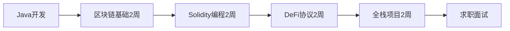
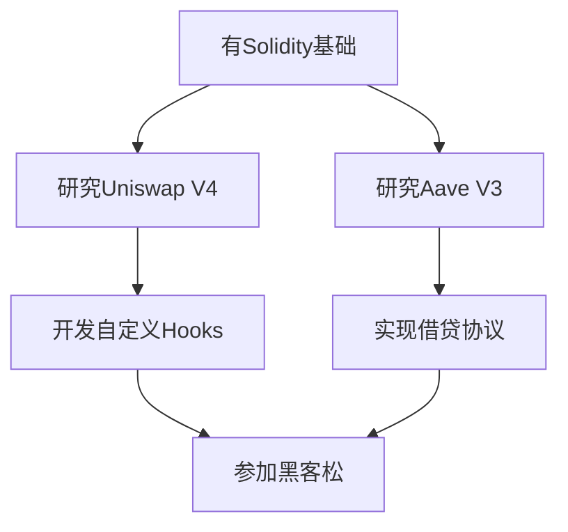

# 🚀 Web3区块链开发学习资源库

> 从Java开发到Web3区块链工程师的完整转型指南 + DeFi协议深度分析

[](https://opensource.org/licenses/MIT)
[](https://docs.soliditylang.org/)
[](https://github.com)

---

## 📚 文档导航

### 🎯 **Java转Web3专项资源**（新增！适合转型开发者）

<table>
<tr>
<td width="50%">

#### 📖 [2个月学习计划](Java转Web3区块链开发_2个月学习计划.md)
**适合**: 6年经验Java开发，2个月内转Web3

**包含**:
- ✅ 8周详细学习路线图（每周目标+检查清单）
- ✅ Java经验迁移策略（分布式→共识、高并发→Gas优化）
- ✅ 精选中英文学习资源（CryptoZombies、WTF Academy）
- ✅ 求职准备指南（简历优化、社区建设、内推渠道）

**时间安排**:
- 第1-2周: 区块链基础+以太坊原理
- 第3-4周: Solidity核心编程
- 第5-6周: DeFi协议深入+安全实践
- 第7-8周: 全栈DApp开发+求职准备

</td>
<td width="50%">

#### 💻 [Solidity快速入门](Solidity快速入门_Java开发者视角.md)
**适合**: Java/后端开发者快速上手Solidity

**包含**:
- ✅ Java vs Solidity语法对比（HashMap→Mapping）
- ✅ Solidity独有概念（view/pure/payable、Events、Gas）
- ✅ 安全编程模式（防重入攻击、CEI模式）
- ✅ 完整代码示例（ERC20、质押、NFT市场）

**核心特色**:
```java
// Java
HashMap<String, Integer> balances;

// Solidity
mapping(address => uint) balances;
```
用熟悉的Java概念类比学习！

</td>
</tr>

<tr>
<td width="50%">

#### 🛠️ [实战项目清单](实战项目清单_2个月冲刺.md)
**适合**: 需要项目经验准备求职的开发者

**3个完整项目**:
1. **质押挖矿平台**（第2-3周）
   - 完整合约+测试+前端
   - 年化收益计算、奖励分配
   
2. **借贷协议**（第4-5周）
   - 类Aave架构、清算机制
   - Chainlink价格预言机
   
3. **NFT交易市场**（第6-7周）
   - 固定价、荷兰拍卖、英式拍卖
   - IPFS集成、版税标准

**每个项目包含**:
- 📦 开箱即用的完整代码
- 📊 完成标准和检查清单
- 💡 GitHub展示技巧

</td>
<td width="50%">

#### 💼 [面试准备与求职](Web3面试准备_求职策略.md)
**适合**: 准备面试Web3岗位的开发者

**包含**:
- ✅ **75+技术面试题**（区块链/Solidity/DeFi/安全）
- ✅ **简历优化策略**（Java经验迁移、量化成果）
- ✅ **目标公司分析**（Uniswap、Aave、Chainlink等）
- ✅ **薪资谈判技巧**（市场行情$60K-$300K）
- ✅ **8周求职时间规划**

**面试题示例**:
- Q: 解释Uniswap的恒定乘积公式
- Q: 如何防止重入攻击？
- Q: 闪电贷的工作原理？
- Q: 设计一个借贷协议架构

</td>
</tr>
</table>

---

### 🏗️ **DeFi协议深度分析**（学习真实世界的代码）

#### Uniswap V4 系列
- 📘 [Uniswap V4 学习文档](Uniswap_V4_学习文档.md) - 协议概述、核心概念、架构分析
- 🚀 [Uniswap V4 快速入门指南](Uniswap_V4_快速入门指南.md) - 5分钟上手、代码示例
- 📊 [Uniswap V4 核心流程图](Uniswap_V4_核心流程图.md) - Swap、流动性管理流程
- 💡 [Uniswap V4 代码实例](Uniswap_V4_代码实例与最佳实践.md) - Hooks开发、最佳实践

#### Aave V3 系列
- 📘 [Aave V3 学习文档](Aave_V3_学习文档.md) - 协议概述、核心特性、集成指南
- 🔬 [Aave V3 技术深度分析](Aave_V3_技术深度分析.md) - 利率模型、清算机制、Gas优化

---

## 🎓 学习路径推荐

### 路径1: 零基础转Web3（8周）


**详细步骤**:
1. **第1天**: 阅读 [2个月学习计划](Java转Web3区块链开发_2个月学习计划.md)，制定个人时间表
2. **第1周**: 完成CryptoZombies课程，理解区块链基础
3. **第2周**: 学习 [Solidity快速入门](Solidity快速入门_Java开发者视角.md)，手写第一个ERC20
4. **第3-4周**: 完成 [实战项目1](实战项目清单_2个月冲刺.md#项目1)（质押挖矿）
5. **第5-6周**: 研究Aave/Uniswap源码，完成项目2（借贷协议）
6. **第7-8周**: 完成全栈DApp，准备 [面试](Web3面试准备_求职策略.md)

---

### 路径2: 已有Web3基础（进阶）


**推荐阅读顺序**:
1. [Uniswap V4 核心流程图](Uniswap_V4_核心流程图.md) - 理解AMM原理
2. [Aave V3 技术深度分析](Aave_V3_技术深度分析.md) - 掌握利率模型
3. [Uniswap V4 代码实例](Uniswap_V4_代码实例与最佳实践.md) - 实战Hooks开发
4. Fork主网协议，本地调试和改进
5. 贡献开源PR或参加ETHGlobal黑客松

---

## 🔥 快速上手（5分钟）

### 方案A: 学习DeFi协议源码
```bash
# 克隆Uniswap V4
git clone https://github.com/Uniswap/v4-core.git
cd v4-core

# 安装依赖
forge install

# 运行测试
forge test -vv

# 阅读文档
# 📖 打开: Uniswap_V4_快速入门指南.md
```

### 方案B: 开发第一个智能合约
```bash
# 创建Hardhat项目
mkdir my-first-defi && cd my-first-defi
npm init -y
npm install --save-dev hardhat @openzeppelin/contracts

# 初始化
npx hardhat init

# 阅读教程
# 📖 打开: Solidity快速入门_Java开发者视角.md
# 复制示例代码到 contracts/MyToken.sol

# 编译和测试
npx hardhat compile
npx hardhat test
```

---

## 💡 核心优势（为什么选择本仓库）

### ✅ 针对Java开发者优化
- **类比学习**: 用Java概念理解Solidity（HashMap→Mapping、synchronized→ReentrancyGuard）
- **经验迁移**: 分布式系统→共识机制、高并发优化→Gas优化
- **避免陷阱**: 列举Java开发者易犯的错误（整数除法、Mapping默认值等）

### ✅ 实战导向
- **完整项目**: 3个生产级DApp（质押、借贷、NFT市场）
- **开箱即用**: 复制代码即可运行，含测试和前端
- **求职优化**: GitHub展示技巧、简历模板、面试题库

### ✅ 真实世界案例
- **Uniswap V4**: AMM机制、集中流动性、Hooks系统
- **Aave V3**: 利率模型、清算机制、跨链设计
- **安全最佳实践**: 防重入、价格预言机、Gas优化

### ✅ 持续更新
- 🔄 跟踪最新DeFi协议版本
- 📝 定期添加新的面试题和项目
- 🌟 社区贡献和反馈改进

---

## 📊 学习成果检查清单

### 第1个月结束（基础巩固）
- [ ] 能独立编写ERC20/ERC721合约
- [ ] 理解Uniswap AMM公式推导
- [ ] 完成至少1个完整智能合约项目
- [ ] 通过Ethernaut前10关安全挑战
- [ ] 掌握Hardhat/Foundry开发流程

### 第2个月结束（求职就绪）
- [ ] GitHub有2-3个可展示的DApp项目
- [ ] 能解释Aave利率模型和清算机制
- [ ] 掌握常见安全漏洞及防范（重入、溢出、权限）
- [ ] 测试覆盖率>90%，通过Slither静态分析
- [ ] 简历投递并获得面试机会

### 进阶目标（持续成长）
- [ ] 给主流DeFi协议提交PR（Uniswap/Aave/Compound）
- [ ] 参加ETHGlobal黑客松并获奖
- [ ] 输出5篇以上技术博客/文档
- [ ] 建立个人Web3品牌（Twitter/Mirror）

---

## 🛠️ 开发环境设置

### 必备工具
```bash
# Node.js (v18+)
node -v

# Foundry（推荐用于智能合约开发）
curl -L https://foundry.paradigm.xyz | bash
foundryup

# Hardhat（备选）
npm install --save-dev hardhat

# VSCode扩展
- Solidity (Juan Blanco)
- Hardhat for Visual Studio Code
```

### 测试网配置
```javascript
// hardhat.config.js
module.exports = {
  networks: {
    sepolia: {
      url: `https://eth-sepolia.g.alchemy.com/v2/YOUR_KEY`,
      accounts: [PRIVATE_KEY]
    }
  }
};
```

### 前端环境
```bash
# React + Ethers.js
npx create-next-app my-dapp
cd my-dapp
npm install ethers wagmi viem @rainbow-me/rainbowkit
```

---

## 🎯 目标公司和岗位

### 顶级DeFi协议
- **Uniswap Labs** - AMM/DEX开发
- **Aave** - 借贷协议工程师
- **MakerDAO** - 稳定币协议
- **Curve Finance** - 算法稳定币

### 基础设施
- **Chainlink** - 预言机工程师
- **The Graph** - 索引和查询
- **Alchemy** - RPC节点服务
- **Infura** - 基础设施

### 交易所和钱包
- **币安** - 智能合约开发
- **OKX** - Web3团队
- **Coinbase** - DeFi产品
- **MetaMask** - 钱包扩展

**薪资范围**: $60K-$300K（取决于经验和公司）

---

## 🌟 成功案例（转型故事）

### 案例1: Java后端 → Uniswap工程师
```
背景: 5年Java微服务开发
转型时间: 3个月
关键行动:
  - 深入研究Uniswap V2/V3源码
  - 开发自定义AMM协议（集成Balancer权重机制）
  - ETHGlobal黑客松获奖
  - 给Uniswap SDK提交3个PR
结果: 收到Uniswap Labs offer（$150K）
```

### 案例2: 传统金融工程师 → Aave安全审计
```
背景: 8年C++金融系统开发
转型时间: 4个月
关键行动:
  - 完成Secureum Bootcamp
  - 发现3个DeFi协议漏洞（负责任披露）
  - 输出10篇安全分析文章
  - 获得Code4rena审计认证
结果: 加入Aave安全团队（$180K + Token）
```

---

## 📚 推荐学习资源

### 中文资源（优先）
- 🎓 [WTF Academy](https://www.wtf.academy/) - Solidity极简教程
- 📖 [登链社区](https://learnblockchain.cn/) - 中文技术文章
- 🎮 [CryptoZombies中文版](https://cryptozombies.io/zh/) - 游戏化学习
- 🏆 [DeCert.me](https://decert.me/) - 边学边拿认证NFT

### 英文资源
- 🎓 [Alchemy University](https://university.alchemy.com/) - 免费7周课程
- 🏃 [Speedrun Ethereum](https://speedrunethereum.com/) - 挑战式学习
- 🔐 [Ethernaut](https://ethernaut.openzeppelin.com/) - 安全挑战
- 💰 [Damn Vulnerable DeFi](https://www.damnvulnerabledefi.xyz/) - DeFi安全

### 开发工具
- 📝 [Solidity by Example](https://solidity-by-example.org/)
- 🔧 [OpenZeppelin Contracts](https://docs.openzeppelin.com/)
- 🧪 [Foundry Book](https://book.getfoundry.sh/)
- 📊 [Tenderly](https://tenderly.co/) - 可视化调试

---

## 🤝 贡献指南

欢迎贡献！请遵循以下步骤：

1. **Fork本仓库**
2. **创建特性分支** (`git checkout -b feature/AmazingFeature`)
3. **提交更改** (`git commit -m 'Add some AmazingFeature'`)
4. **推送到分支** (`git push origin feature/AmazingFeature`)
5. **开启Pull Request**

### 贡献类型
- 📝 改进现有文档（修正错误、补充内容）
- 💡 添加新的代码示例
- 🎯 分享转型经验和面试题
- 🐛 报告文档中的问题

---

## 📞 联系和反馈

### 问题反馈
- 📧 GitHub Issues: [提交问题](../../issues)
- 💬 Discussions: [参与讨论](../../discussions)

### 社区交流
- 🐦 关注Web3技术博主
- 💬 加入登链社区Discord
- 🎤 参加本地Web3 Meetup

---

## 📄 许可证

本仓库文档采用 [MIT License](LICENSE) 许可证。

**免责声明**: 
- 本文档仅用于教育和学习目的
- 智能合约涉及资金安全，生产部署前请进行充分测试和审计
- DeFi投资存在风险，请谨慎操作
- 代码示例不构成财务建议

---

## 🚀 立即开始

**选择你的起点**:

1. **完全零基础** → 阅读 [2个月学习计划](Java转Web3区块链开发_2个月学习计划.md)
2. **会Solidity基础** → 直接看 [实战项目清单](实战项目清单_2个月冲刺.md)
3. **准备面试** → 刷 [面试题库](Web3面试准备_求职策略.md)
4. **研究DeFi协议** → 深入 [Uniswap V4](Uniswap_V4_学习文档.md) 或 [Aave V3](Aave_V3_学习文档.md)

---

<div align="center">

**⭐ 如果本仓库对你有帮助，请给个Star！**

**💪 2个月后，你将成为一名合格的Web3开发者！**

</div>

---

### 📌 快速链接

| 文档 | 适合人群 | 预计时间 |
|------|---------|---------|
| [2个月学习计划](Java转Web3区块链开发_2个月学习计划.md) | 转型新手 | 8周 |
| [Solidity快速入门](Solidity快速入门_Java开发者视角.md) | Java开发者 | 1周 |
| [实战项目清单](实战项目清单_2个月冲刺.md) | 需要项目经验 | 4-6周 |
| [面试准备](Web3面试准备_求职策略.md) | 准备求职 | 2周 |
| [Uniswap V4学习](Uniswap_V4_学习文档.md) | 进阶开发者 | 持续 |
| [Aave V3分析](Aave_V3_技术深度分析.md) | 进阶开发者 | 持续 |

**最后更新**: 2024-10-09 | **维护者**: Web3学习社区
